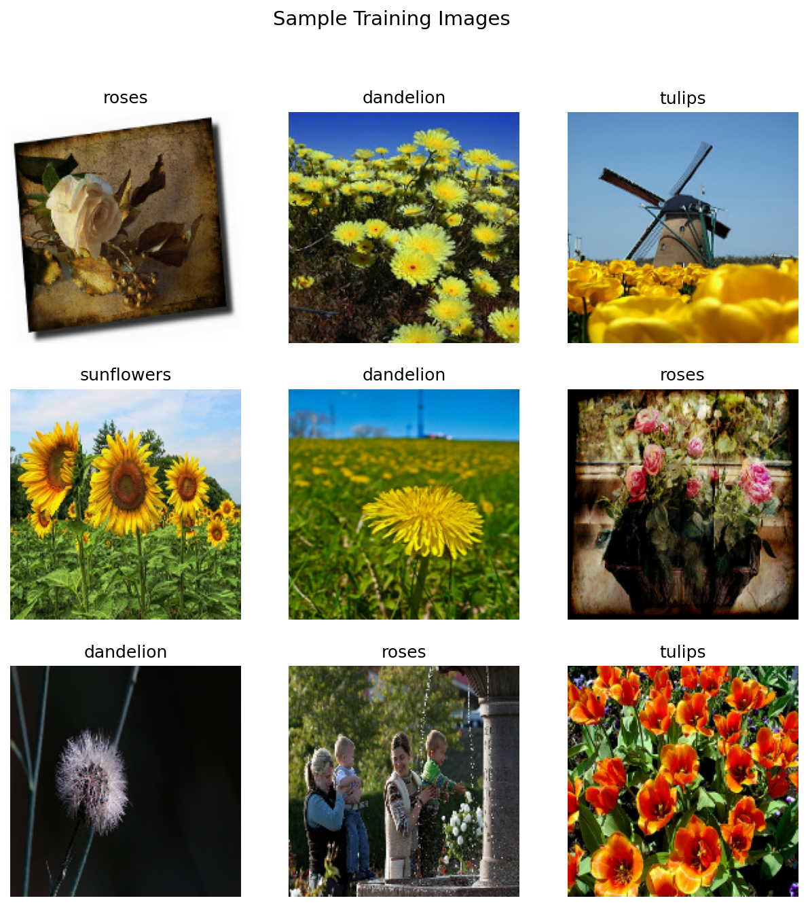
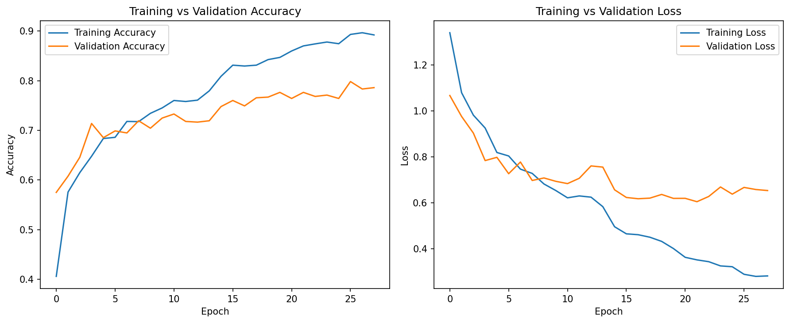
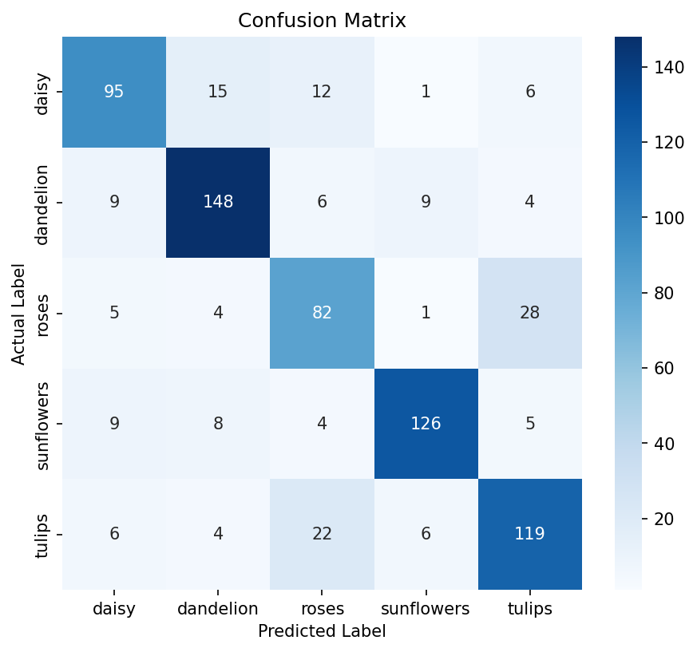
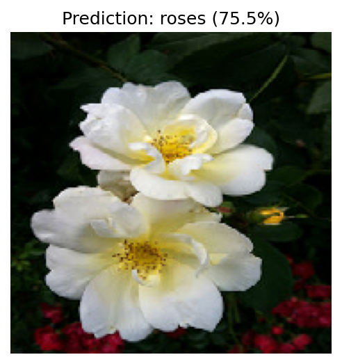
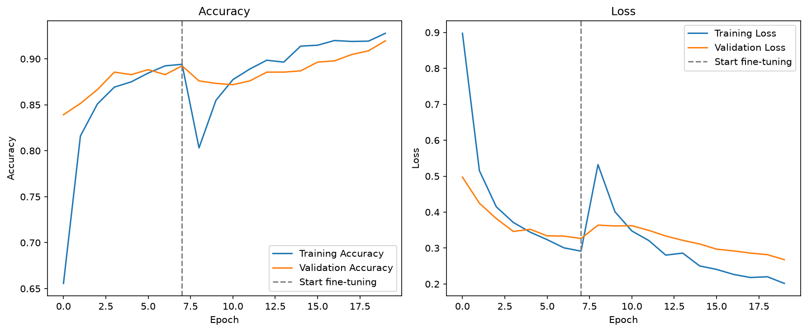
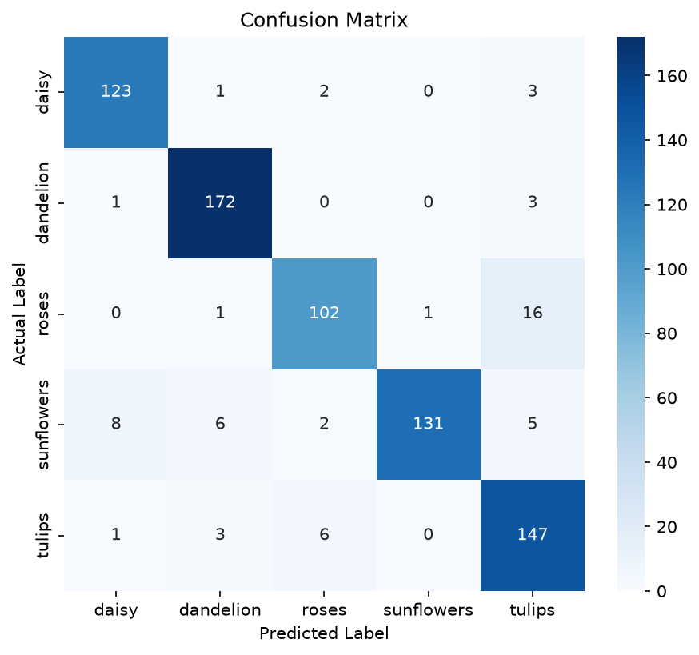

# Flower Recognition Using Deep Learning (CNN and MobileNetV2)

A deep learning project that classifies flower images into five categories using two models built with TensorFlow and Keras: a custom CNN trained from scratch and a MobileNetV2 transfer learning model. A Streamlit web app lets you try both models.

## Problem Statement

Many flower species look very similar in shape, color, and texture, and identifying them manually requires expertise and is slow and error-prone. Traditional machine learning methods depend on hand-crafted features and perform poorly when lighting, background, angle, and scale vary.

The goal of this project is to design and train deep learning models that automatically classify flower images into five categories (daisy, dandelion, roses, sunflowers, tulips), and to evaluate them using accuracy, loss curves, a confusion matrix, and a classification report.

## Dataset

- **Name:** TensorFlow Flowers dataset (`flower_photos`)
- **Images:** about 3,600 RGB images
- **Classes (5):** daisy, dandelion, roses, sunflowers, tulips
- **Split:** 80% training, 20% validation (734 validation images, same split for both models)
- **Image size:** 180 x 180 for the custom CNN, 224 x 224 for MobileNetV2

The training scripts download the dataset automatically. A copy is also included in `dataset/` so the web app's sample images and quiz work.

## Model 1: Custom CNN

| Layer | Purpose |
|---|---|
| Data Augmentation | Random flip, rotation, zoom, and contrast to reduce overfitting |
| Rescaling | Scales pixel values from 0-255 to 0-1 |
| 4 x (Conv2D + MaxPooling) | Filters 32, 64, 128, 256 to extract features |
| Dropout (0.3) | Prevents overfitting |
| Flatten + Dense (256) | Combines the features |
| Dense (5) | Output layer, one score per class |

- **Optimizer:** Adam
- **Loss:** Sparse Categorical Cross-Entropy
- **Callbacks:** Early Stopping, Reduce Learning Rate on Plateau

## Model 2: MobileNetV2 (Transfer Learning)

- **Base model:** MobileNetV2 pretrained on ImageNet
- **Phase 1:** base frozen, only the new classifier is trained (Adam, learning rate 1e-3, 8 epochs)
- **Phase 2:** last 30 layers of the base are unfrozen and fine-tuned (Adam, learning rate 1e-5)
- **Augmentation:** random flip, rotation, zoom
- **Callbacks:** Early Stopping, Reduce Learning Rate on Plateau

## Model Comparison

| Model | Approach | Validation Accuracy |
|---|---|---|
| Custom CNN | Trained from scratch | 77.66% |
| MobileNetV2 | Transfer learning + fine-tuning | 91.96% |

Transfer learning improved validation accuracy by about 14.3 percentage points.

## Results: Custom CNN

- **Validation Accuracy:** 77.66%
- **Validation Loss:** 0.6047

| Class | Precision | Recall | F1-score | Support |
|---|---|---|---|---|
| daisy | 0.77 | 0.74 | 0.75 | 129 |
| dandelion | 0.83 | 0.84 | 0.83 | 176 |
| roses | 0.65 | 0.68 | 0.67 | 120 |
| sunflowers | 0.88 | 0.83 | 0.85 | 152 |
| tulips | 0.73 | 0.76 | 0.75 | 157 |
| **Overall accuracy** | | | **0.78** | 734 |

The custom CNN performs best on sunflowers (F1 0.85) and dandelions (F1 0.83), which have distinctive shapes and colors. Roses are the hardest class (F1 0.67) because their petal shape and color overlap with tulips and daisies.









## Results: MobileNetV2

- **Validation Accuracy:** 91.96%
- **Validation Loss:** 0.2676

| Class | Precision | Recall | F1-score | Support |
|---|---|---|---|---|
| daisy | 0.92 | 0.95 | 0.94 | 129 |
| dandelion | 0.94 | 0.98 | 0.96 | 176 |
| roses | 0.91 | 0.85 | 0.88 | 120 |
| sunflowers | 0.99 | 0.86 | 0.92 | 152 |
| tulips | 0.84 | 0.94 | 0.89 | 157 |
| **accuracy** | | | **0.92** | **734** |
| **macro avg** | **0.92** | **0.92** | **0.92** | **734** |
| **weighted avg** | **0.92** | **0.92** | **0.92** | **734** |

MobileNetV2 achieved better classification performance than the custom CNN. It performed particularly well on dandelions, with an F1-score of 0.96. Sunflowers achieved the highest precision of 0.99, while tulips achieved a recall of 0.94.





## Web App (Streamlit)

The app has tabs for predicting on your own images, comparing both models on one image, a flower quiz, a dataset explorer, model performance, and prediction history.

```bash
python -m streamlit run app.py
```

## Project Structure

```text
├── flower_cnn.py              # custom CNN training
├── flower_transfer.py         # MobileNetV2 transfer learning
├── app.py                     # Streamlit web app
├── requirements.txt
├── flower_cnn_model.keras
├── flower_mobilenet_model.keras
├── dataset/                   # flower images for the app
└── *.png                      # result graphs
```

## How to Run

1. Clone the repository

```bash
git clone https://github.com/Himanshu1234-art/flower-recognition-cnn.git
cd flower-recognition-cnn
```

2. Install the requirements

```bash
pip install -r requirements.txt
```

3. Run the web app (trained models are included)

```bash
python -m streamlit run app.py
```

To retrain, run `python flower_cnn.py` and `python flower_transfer.py`.

## Tech Stack

Python, TensorFlow, Keras, Streamlit, NumPy, Pandas, Pillow, Matplotlib, Seaborn, scikit-learn

## Future Improvements

- Evaluate on a separate held-out test set
- Train on more flower classes (Oxford 102 Flowers)
- Deploy the app online

## Author

Himanshu Mishra